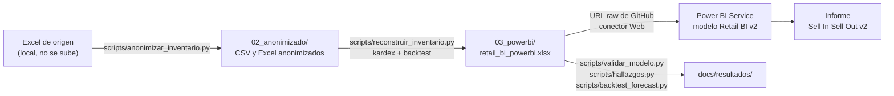

# Retail de lujo · Sell In, Sell Out, Inventario y Forecast en Power BI

Caso de Business Intelligence sobre datos **reales y anonimizados** de una empresa de retail de lujo (relojería,
joyería y accesorios). Relaciona compras, ventas e inventario, reconstruye el stock mensual, calcula el punto de
reorden por marca y proyecta el cierre del año contra el presupuesto.

> **Sobre los datos.** Proveedores, marcas, productos, clientes y vendedores están codificados (`PROV####`, `MARC####`,
> `SKU#####`). Los importes están escalados. Las unidades, las fechas y las proporciones son reales.

## 1. Problema de negocio

La empresa importa la mayor parte de su mercancía, con plazos de entrega de un mes. El área comercial y la de compras
trabajaban con hojas de Excel separadas, sin un histórico de inventario que cuadrara con compras y ventas. No había
una forma rápida de saber si se estaba comprando lo que se vendía, cuánto stock estaba parado, qué reponer ni cómo iba
a cerrar el año.

## 2. Objetivos

1. Unificar compras (Sell In), ventas (Sell Out) e inventario en un solo modelo.
2. Reconstruir el inventario mensual por producto y medir su precisión.
3. Dar una regla de reposición por marca (punto de reorden y compra sugerida).
4. Comparar el presupuesto con el cierre esperado del año (Budget, Forecast y Rolling Forecast).
5. Documentar los problemas de calidad de datos que afectan a las decisiones.

## 3. Preguntas que responde

| Pregunta | Página del informe |
|---|---|
| ¿Estamos vendiendo lo que compramos? | Resumen anual, Compras |
| ¿Qué marcas, proveedores y departamentos crecen o caen? | Ventas |
| ¿Cuánto inventario hay, cuánto rota y cuánto está parado? | Inventario |
| ¿Qué marcas hay que reponer y cuánto comprar? | Inventario (punto de reorden) |
| ¿Cómo cerraremos el año contra el presupuesto? | Budget / Forecast |

## 4. Herramientas

Python (pandas, openpyxl, pytest) · Excel · Power Query · Power BI Service · DAX · Git y GitHub.

## 5. Arquitectura del proceso



La limpieza (columnas vacías, tipos, marcas Sí/No de casos dudosos) se hizo en el Excel antes de Power BI. Power Query
solo lee las tablas y excluye 6 compras con error de captura.

## 6. Modelo de datos

Modelo en estrella con 3 tablas de hechos y 8 dimensiones. Detalle, diagrama y riesgos: [`docs/modelo_datos.md`](docs/modelo_datos.md).
Diccionario de columnas: [`docs/diccionario_datos.md`](docs/diccionario_datos.md).

| Tabla de hechos | Una fila es… | Filas | Periodo |
|---|---|---:|---|
| Ventas | Una línea de factura o nota de crédito | 49.936 | ene-2023 a jun-2026 |
| Compras | Una línea de recepción | 16.721 (16.715 tras excluir 6 errores) | ene-2024 a abr-2026 |
| Inventario | El stock de un SKU al cierre de un mes | 144.350 | dic-2023 a abr-2026 |

Dimensiones: Producto (17.721), Cliente (13.090), Proveedor (165), Marca (141), Vendedor (89), Almacén (13),
Departamento (12) y Calendario (2023–2026).

## 7. Indicadores principales

Unas 140 medidas DAX, documentadas en [`03_powerbi/MODELO.md`](03_powerbi/MODELO.md) y
[`03_powerbi/prompts/`](03_powerbi/prompts/). El catálogo, con fórmula, granularidad, interpretación y limitaciones de
cada KPI, está en [`docs/catalogo_kpi.md`](docs/catalogo_kpi.md).

| Área | Indicadores |
|---|---|
| Ventas y compras | Sell In, Sell Out, variación contra el año anterior, sell-through, ticket, margen, devoluciones, lead time, factor de importación |
| Inventario | Stock final, rotación, días de inventario, cobertura, stock sin venta 12 meses, SKU en quiebre, venta perdida |
| Reposición | Demanda mensual, stock de seguridad (95 %), punto de reorden, compra sugerida, marcas en sobrestock |
| Planificación | Estacionalidad, Budget, Forecast, Rolling Forecast, stock proyectado |

## 8. Metodología

- **Inventario.** Hasta jun-2025 se usan las fotos reales de cierre de mes. Desde ahí se aplica un kardex
  (stock = stock anterior + compras − ventas), calibrado con el resumen de inventario por marca hasta dic-2025. En 2026
  no hay calibración.
- **Punto de reorden por marca.** Demanda de los últimos 6 meses, lead time real (unos 32 días) y nivel de servicio del
  95 %: stock de seguridad = 1,65 × σ × √lead time. Se pide hasta el punto de reorden + 1 mes de demanda.
- **Budget.** Venta del año anterior × crecimiento esperado (1,20), repartida por mes con la estacionalidad 2024–2025.
- **Forecast.** Proyección determinística, no un modelo estadístico: unidades = pieza promedio de 12 meses ×
  estacionalidad; importe = unidades × precio medio de 12 meses; compra del mes = venta del mes anterior.
- **Rolling Forecast.** Real hasta el último inventario (30-abr-2026) y forecast después.

## 9. Resultados

Cada cifra de esta sección se recalcula con `scripts/hallazgos.py` (resultado en
[`docs/resultados/hallazgos.md`](docs/resultados/hallazgos.md)). Las **causas** son interpretaciones validadas con el
negocio; los datos por sí solos no demuestran causalidad.

### 9.1 Se compra más mientras se vende menos
- **Dato:** en ene–abr 2026 las compras a costo Ex-Work fueron **4,5 veces** las de ene–abr 2025, mientras la venta
  cayó un **7,3 %**. El sell-through en unidades bajó de 1,30 a **0,78**.
- **Contexto:** en 2024 se compró de más (sell-through 0,69) y en 2025 se vendió ese stock (1,16).
- **Causa (validada con el negocio):** una disrupción logística internacional a finales de 2025 retrasó los pedidos a
  proveedores del exterior, que se recibieron todos juntos a principios de 2026. Es un desfase, no una sobrecompra.
- **Recomendación:** leer la tendencia por semestre o año, atar las compras al Rolling Forecast y al punto de reorden,
  y tener un plan de contingencia logística (más stock de seguridad en las marcas top en los periodos de riesgo).

### 9.2 La caída de 2026 es de precio medio, no de volumen
- **Dato:** en ene–abr 2026 contra 2025, las unidades apenas cambian (−1,7 %), las facturas suben un 1,2 % y los
  clientes un 6 %, pero el **ticket promedio baja un 11 %**.
- **Dónde:** en Relojería (58 % de la venta) el precio por pieza cae un **29 %** y las unidades suben un 16 %. Su margen
  sube del 36 % al 42 %.
- **Causa (validada):** como el margen no baja, no es una política de descuentos. Es un **cambio de mezcla**: hubo menos
  relojes de alta gama disponibles por la misma disrupción, y se vendieron piezas de menor precio.
- **Contrapunto:** Joyería crece un 10 %, con más precio por pieza y un margen que sube del 51 % al 59 %.
- **Recomendación:** medir la venta perdida en alta gama y priorizar esas referencias en los pedidos internacionales.

### 9.3 El inventario se duplicó y casi la mitad no rota
- **Dato:** el stock pasó de 7.089 unidades (dic-2023) a **15.452** (abr-2026), un +118 %, con la venta en unidades
  estable. El **46 %** de las unidades no tuvo ninguna venta en 12 meses. **38 de 88 marcas** con venta tienen más de
  12 meses de cobertura. Belleza y Accesorios guardan el 25 % del stock y suman menos del 3 % de la venta.
- **Causa (validada):** los mínimos de pedido de los proveedores obligan a comprar más de lo que se vende en las
  categorías de menor rotación, más la llegada acumulada de 2026.
- **Recomendación:** plan de liquidación del stock sin venta, frenar compras a las marcas en sobrestock y negociar
  mínimos más bajos o pedidos combinados en Belleza y Accesorios.

### 9.4 Pocas marcas a reponer, pero son las que venden
- **Dato:** **7 marcas** están por debajo del punto de reorden y la compra sugerida es de **308 unidades**. El 80 % de
  la venta lo hacen 15 de 141 marcas. `MARC0004` (8 % de la venta) vende más de lo que se le compra (sell-through 1,27).
- **Causa (validada):** la disrupción logística retrasó la reposición de estas marcas.
- **Recomendación:** reasignar la compra hacia las marcas que concentran la venta. La compra total no tiene que subir.

### 9.5 El cierre de 2026 queda por debajo del presupuesto
- **Dato:** con un presupuesto de +20 % sobre 2025, el Rolling Forecast cierra **22,5 %** por debajo del budget de
  ventas, y un 7 % por debajo de la venta de 2025. Diciembre vale unas **3 veces** un mes medio en importe (2,5 en
  unidades).
- **Matiz:** el backtest del forecast muestra que el método subestima cuando el negocio crece o sube el precio (sección
  11). El −22,5 % es, probablemente, un escenario conservador.
- **Recomendación:** recalibrar el presupuesto con la tendencia real y asegurar el stock de las marcas top antes de
  octubre, porque el lead time es de un mes.

### 9.6 La concentración es un riesgo
- **Dato:** el Almacén 1 factura el 89 % de la venta: es una tienda y además el punto central de facturación, así que
  la venta por almacén no equivale a la venta por tienda. **78 de 13.090 clientes** hacen el 50 % de la venta, y el
  primero el 7,6 %.
- **Recomendación:** programa de atención personalizada para los clientes VIP, con seguimiento de su frecuencia de compra.

### 9.7 Calidad de datos que afecta a las decisiones
- **Recepciones sin registrar:** en 463 casos (SKU y mes) se vendió más de lo que había en stock, y el kardex puro
  subestima el inventario un 22 % a 6 meses. Validado: se vendía mercancía que aún no estaba registrada en Compras.
- **Errores de captura:** 6 devoluciones duplicadas con costo erróneo hacían que el factor de importación de 2026 saliera
  en 1,88 (marzo en −9,88). Sin ellas sale en 1,27. Se excluyen en Power Query.
- **Compras sin clasificar:** 1.384 compras (8,4 % del Sell In) no tienen tipo de movimiento ni factor de importación.
- **Recomendación:** conciliar recepciones físicas contra Compras cada mes, hacer obligatorio el tipo de movimiento y
  validar los costos atípicos antes de cerrar el mes.

## 10. Controles de calidad

`scripts/validar_modelo.py` ejecuta 68 controles sobre el Excel que lee Power BI: claves únicas, claves huérfanas,
nulos, fechas, devoluciones, duplicados, costos, consistencia entre tablas, confidencialidad y totales contra Power BI.

Resultado del 17-oct-2026: **48 OK, 15 avisos (casos legítimos o tratados), 5 a revisar y 0 errores**. Los 7 totales de
control (ventas, compras y stock en 3 fechas) coinciden con lo que muestra Power BI. Detalle:
[`docs/resultados/controles_calidad.md`](docs/resultados/controles_calidad.md).

## 11. Validación del inventario y del forecast

Detalle completo en [`docs/validacion.md`](docs/validacion.md).

**Inventario.** Se reconstruyó ene–jun 2025 desde la foto real de dic-2024 y se comparó con las fotos reales de cada mes.

| Método | Error del total a 6 meses | Media de 6 meses | WAPE por SKU a 6 meses |
|---|---:|---:|---:|
| Kardex puro (sin información del periodo evaluado) | −22,1 % | −14,6 % | 27 % |
| Kardex calibrado con el resumen por marca | −7,3 % | −9,4 % | 39 % |

Error del total = (estimado − real) / real; negativo = subestima. El método calibrado usa el resumen de inventario de
los mismos meses que evalúa, así que su −7,3 % **no** es la precisión de una estimación a ciegas: esa es la del kardex
puro (−22,1 %). El sesgo negativo confirma las recepciones sin registrar (9.7).

**Forecast.** Backtest con corte en abr-2025, forecast de may–dic 2025 contra el real, sin usar datos posteriores al
corte, y comparado con dos métodos base.

| Nivel | WAPE método del informe | WAPE mismo mes del año anterior | WAPE promedio plano |
|---|---:|---:|---:|
| Total mensual, unidades | **15,9 %** | 22,7 % | 29,3 % |
| Total mensual, importe | **30,0 %** | 34,7 % | 39,6 % |
| Marca × mes, unidades | 65,6 % | 69,6 % | **60,9 %** |

El método del informe es el mejor a nivel total y departamento, pero subestima (−15,6 % en unidades) porque no tiene
tendencia. Por marca no es fiable.

## 12. Limitaciones

- Desde jul-2025 el inventario es estimado, y en 2026 sin calibración (sesgo a la baja).
- Los traspasos entre almacenes no están en los datos: el sell-through no se lee por tienda.
- Hay 2.308 ventas de may–jun 2026 sin compras ni inventario de esos meses. El forecast las excluye.
- Las comparaciones con el año anterior de Resumen anual se cortan en la última venta (8-jun) y las compras terminan el
  30-abr. La propuesta de un corte único está en `03_powerbi/prompts/05_correcciones_auditoria.md`.
- El filtro de proveedor podría no llegar a las medidas de inventario (por validar, mismo prompt).
- Los posibles duplicados (1,95 % del importe de ventas) y las ventas con costo 0 se marcan, pero no se excluyen.
- Los importes absolutos no son los reales.

## 13. Estructura del repositorio

| Carpeta | Contenido |
|---|---|
| `02_anonimizado/` | Datos anonimizados en CSV y Excel, incluidas las fotos de inventario por SKU |
| `03_powerbi/` | Excel que lee Power BI, documentación del modelo (`MODELO.md`), estado (`ESTADO_PROYECTO.md`) y prompts usados para construir cada página |
| `04_presentacion/` | Bocetos de las páginas y carpeta `capturas/` |
| `docs/` | Auditoría, modelo de datos, diccionario, catálogo de KPI, validación y guía de capturas |
| `docs/resultados/` | Salidas de los scripts de control y validación |
| `scripts/` | Python: anonimización, reconstrucción del inventario, controles, hallazgos y backtest |
| `tests/` | Pruebas con pytest |

Los datos originales (`00_original/`, `01_mapeos/`, `trabajo/`) no se suben al repo.

## 14. Cómo reproducir

```bash
git clone https://github.com/mgabrielafiguera-pixel/proyecto-bi-retail.git
cd proyecto-bi-retail
python3 -m pip install -r requirements.txt

python3 scripts/validar_modelo.py      # controles de calidad → docs/resultados/controles_calidad.md
python3 scripts/hallazgos.py           # cifras de la sección 9 → docs/resultados/hallazgos.md
python3 scripts/backtest_forecast.py   # backtest del forecast → docs/resultados/backtest_forecast.md
python3 -m pytest tests                # 12 pruebas, incluido el backtest del inventario
```

`scripts/reconstruir_inventario.py` reescribe la tabla Inventario del Excel que lee Power BI. Para probarlo sin tocarlo:
`python3 scripts/reconstruir_inventario.py --xlsx /ruta/a/una/copia.xlsx`.

El informe se construyó en Power BI Service con los prompts de `03_powerbi/prompts/`, en orden (`00` a `05`).

## 15. Capturas del informe

Pendientes. Se guardarán en [`04_presentacion/capturas/`](04_presentacion/capturas/) siguiendo
[`docs/guia_capturas_pdf.md`](docs/guia_capturas_pdf.md). Mientras tanto, hay bocetos (no capturas) en `04_presentacion/`.

## 16. Informe en PDF

Pendiente: `04_presentacion/informe_sell_in_sell_out.pdf`, exportado desde Power BI Service.

## 17. Conclusiones y mejoras futuras

**Conclusiones (interpretación de los resultados de la sección 9).** El problema de 2026 no es de demanda (las unidades y los clientes se mantienen), sino de **logística y
surtido**: llegó tarde la mercancía de alta gama, se acumuló stock de baja rotación y faltan las marcas que más venden.
La decisión con más impacto es reasignar la compra hacia las 15 marcas que hacen el 80 % de la venta y liquidar el
stock sin movimiento.

**Mejoras futuras.**
- Añadir tendencia al forecast (por ejemplo, crecimiento interanual de los últimos 12 meses) y repetir el backtest.
- Conciliar recepciones físicas y Compras para poder anclar el inventario de 2026.
- Exportar las medidas del modelo al repo para auditar el DAX real.
- Registrar los traspasos entre almacenes para leer el sell-through por tienda.

Auditoría completa del proyecto: [`docs/auditoria.md`](docs/auditoria.md) · Resumen ejecutivo:
[`docs/resumen_ejecutivo.md`](docs/resumen_ejecutivo.md) · Cambios: [`CHANGELOG.md`](CHANGELOG.md).
