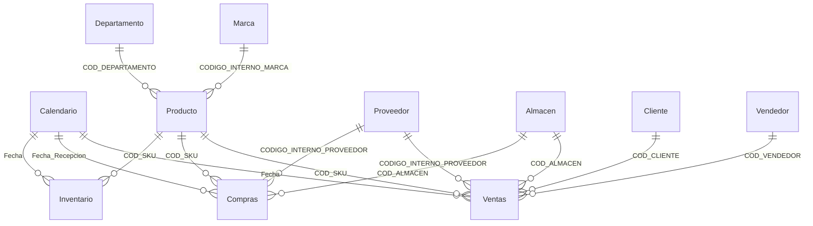

# Modelo de datos

Modelo semántico **Retail BI v2** en Power BI Service. Lee `03_powerbi/retail_bi_powerbi.xlsx` desde la URL raw de
GitHub (rama `main`). Las medidas DAX están en [`03_powerbi/MODELO.md`](../03_powerbi/MODELO.md).

## Diagrama

Todas las relaciones son uno a varios, activas y con filtro en una sola dirección (de la dimensión a la tabla de
hechos). Hay 14 relaciones: las 12 originales más Producto → Inventario y Calendario → Inventario.

Además hay 4 tablas sin relaciones, creadas en el Service: `Medidas` (contenedor de medidas), `Tipo Costo` (selector
Ex-Work o puesto), `Proyeccion` (crecimiento de 0,80 a 2,00) y `Ranking por` (parámetro de campo de la página
Inventario).

## Tablas y granularidad

| Tabla | Tipo | Una fila es… | Filas | Clave | Periodo |
|---|---|---|---:|---|---|
| Ventas | Hechos | Una línea de factura o nota de crédito | 49.936 | Sin clave única (no hay número de línea) | 3-ene-2023 a 8-jun-2026 |
| Compras | Hechos | Una línea de recepción de mercancía | 16.721 (16.715 tras Power Query) | Sin clave única | 10-ene-2024 a 30-abr-2026 |
| Inventario | Hechos (foto) | Stock de un SKU al cierre de un mes | 144.350 | COD_SKU + Fecha | dic-2023 a abr-2026 |
| Producto | Dimensión | Un SKU | 17.721 | COD_SKU | |
| Marca | Dimensión | Una marca | 141 | CODIGO_INTERNO_MARCA | |
| Departamento | Dimensión | Un departamento | 12 | COD_DEPARTAMENTO | |
| Proveedor | Dimensión | Un proveedor | 165 | CODIGO_INTERNO_PROVEEDOR | |
| Almacen | Dimensión | Un almacén o tienda | 13 | COD_ALMACEN | |
| Cliente | Dimensión | Un cliente | 13.090 | COD_CLIENTE | |
| Vendedor | Dimensión | Un vendedor | 89 | COD_VENDEDOR | |
| Calendario | Dimensión de fechas | Un día | 1.461 | Fecha | 2023 a 2026 |

`Inventario` es una tabla de **foto** (semi-aditiva): sus unidades se suman entre productos, pero **no entre meses**.
Por eso las medidas de stock buscan siempre el último día del periodo filtrado (`Stock Final Uds`) en lugar de sumar.

Los controles de `scripts/validar_modelo.py` comprueban que las 8 dimensiones tienen claves únicas, que ninguna
relación tiene claves huérfanas y que Inventario no tiene duplicados SKU + Fecha. Resultados en
[`resultados/controles_calidad.md`](resultados/controles_calidad.md).

## Decisiones de diseño y sus riesgos

### 1. Proveedor se relaciona con las tablas de hechos, no con Producto

**Por qué:** Producto, Ventas y Compras tienen columna de proveedor. Si Proveedor se relacionara con Producto y también
con Ventas, habría dos caminos de filtro hacia Ventas y Power BI daría un error de ambigüedad.

**Riesgo 1, por validar en Power BI:** Inventario no tiene columna de proveedor y solo se relaciona con Producto. Si en
una página se elige **solo** un proveedor, las medidas de stock (stock final, rotación, cobertura, punto de reorden,
stock proyectado) **no se filtran** y muestran el total de la empresa. Las de ventas y compras sí se filtran. El resultado
sería, por ejemplo, una rotación que mezcla las ventas de un proveedor con el stock de todos. La prueba y la corrección
están en [`docs/auditoria_dax.md`](auditoria_dax.md), hallazgo D1.

**Riesgo 2, comprobado en los datos:** en 173 líneas de venta (0,35 %) y 55 de compra (0,33 %), el proveedor de la línea
no es el proveedor que tiene el producto en la tabla Producto. Un filtro por proveedor (que usa la línea) y un filtro por
sus marcas (que usa Producto) pueden dar totales algo distintos. Es un efecto pequeño y se documenta.

### 2. Compras se fechan por la recepción

Las compras se relacionan con Calendario por `Fecha_Recepcion`, que está completa, y no por la fecha de factura (falta
en 1.262 líneas). Es la fecha en que la mercancía entra al inventario, así que es coherente con el kardex.

### 3. Inventario reconstruido

Hasta jun-2025 son fotos reales; después, estimaciones (columna `Origen`). Ver [`validacion.md`](validacion.md).

### 4. Calendario

Está marcada como tabla de fechas. `Nombre_Mes` se ordena por `Mes`. Cubre 2023–2026 completos, de modo que las
funciones de inteligencia de tiempo (`SAMEPERIODLASTYEAR`, `DATESYTD`, `DATESINPERIOD`) funcionan.

### 5. Sin tabla de presupuesto

El presupuesto se calcula con DAX (venta del año anterior × proyección × estacionalidad), así que no hace falta una
tabla de hechos de presupuesto. La contrapartida es que el presupuesto no se puede cargar ni ajustar a mano.

## Riesgos de doble conteo

| Caso | ¿Duplica? | Por qué |
|---|---|---|
| Dimensión con claves repetidas | No | Las 8 claves son únicas (control automático) |
| Sumar stock entre meses | Evitado | Las medidas de stock toman el último día del periodo |
| Ventas y Compras en el mismo visual | No | Cada una se filtra por su propia relación; no hay relación directa entre ellas |
| Líneas marcadas como posible duplicado | Posible | 1.009 líneas sobrantes en Ventas (1,95 % del importe) y 599 en Compras. Se marcan y no se borran, porque sin número de línea no se puede distinguir un error de dos piezas iguales |
